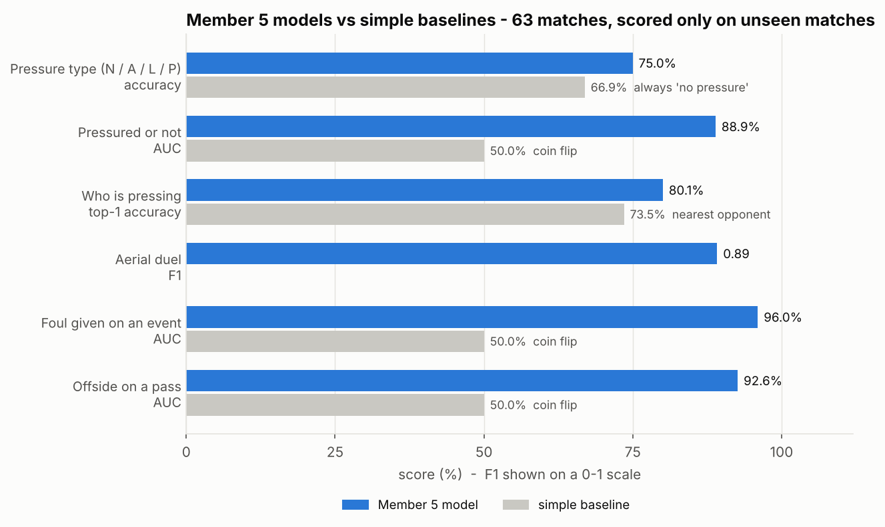
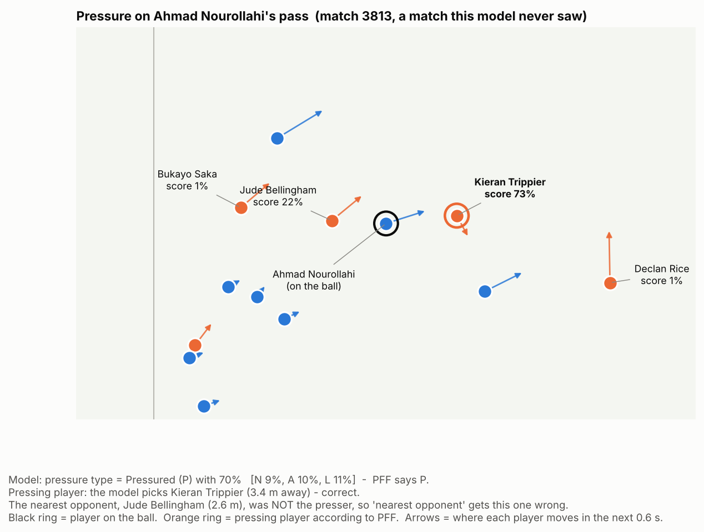
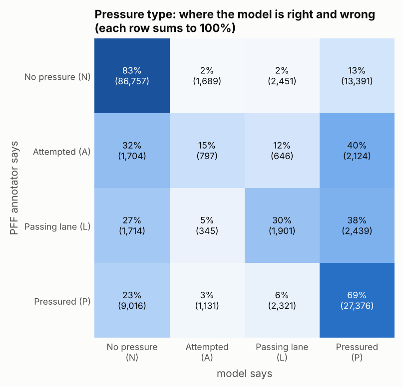
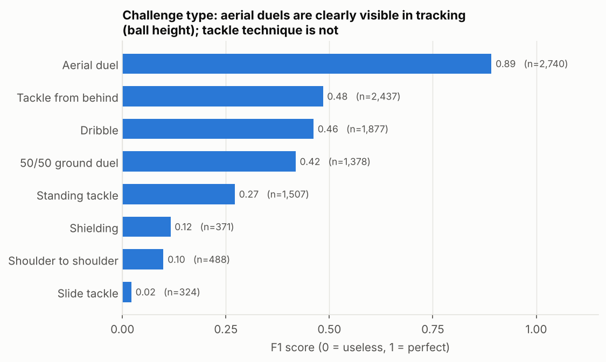
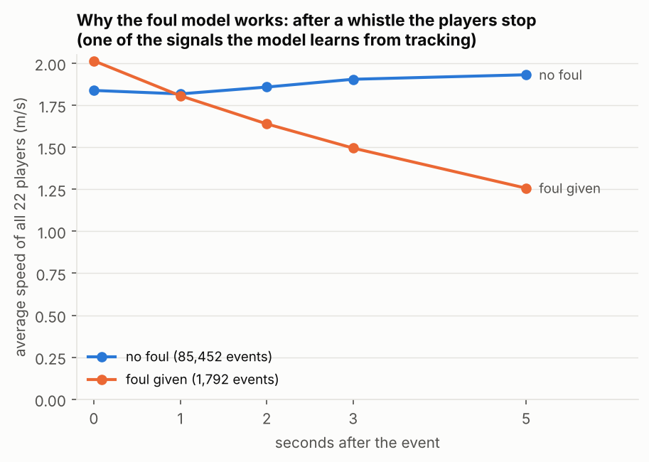
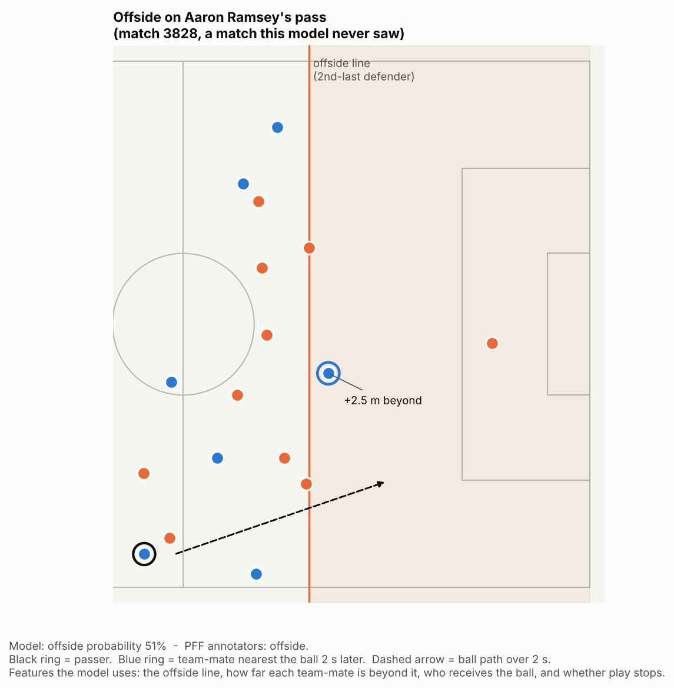
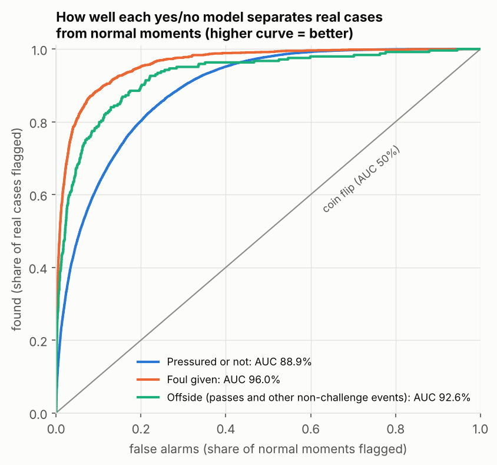

# Member 5: Challenges, Pressure & Fouls

Predicting PFF FC event labels for **pressure**, **challenges** and **fouls / offside** from
FIFA World Cup 2022 broadcast tracking data. PFF's event data is used only as the
training labels and to score the models.



Every number on this page comes from matches the model **did not see** during training
(5-fold cross-validation split by match, 63 matches; the final, match 10517, is kept out entirely).

## What works

| Question | Result | Simple baseline |
|---|---|---|
| Pressure type (N / A / L / P) | **75.0%** accuracy | 66.9% (always "no pressure") |
| Is the player pressured? | **AUC 88.9%** | 50% (coin flip) |
| Who is pressing? | **80.1%** top-1, **91.8%** in top 2 | 73.5% (nearest opponent) |
| Aerial duel (challenge type A) | **F1 0.89** | - |
| Was a foul given on this event? | **AUC 96.0%** | 50% |
| Offside on a pass | **AUC 92.6%** | 50% |

All other metrics, including the weaker tasks, are in [RESULTS.md](RESULTS.md).

## How it works

**1. Data.** PFF tracking (about 30 frames per second, 22 players and the ball) is converted
from ~860 MB of JSON per match to a ~10 MB compact file (`pff5/preprocess.py`). Events are
lined up with tracking frames by video time.

**2. The honest ball.** PFF's `ballsSmoothed` is placed on the player the annotators marked as
having the ball, so it leaks the labels. All models here use the **raw broadcast ball**,
cleaned (`pff5/data.py: clean_raw_ball`).

**3. Features.** Instead of raw coordinates, the models get football measurements computed
from tracking (`pff5/features.py`): distances, closing speed, angles, passing lanes, ball
height, the offside line, and what happens in the seconds after an event.

**4. Models.** LightGBM gradient-boosted trees (`pff5/train.py`). Folds are always split **by
match**, never by row, so frames from one match never appear in both training and scoring.

### Pressure

For each moment PFF labels (the first touch, and the pass / carry / shot), the model is given
the frame and the player on the ball. It measures the **6 nearest opponents**: distance at
7 moments from -1 s to +1 s, **closing speed**, time to contact, front or behind, distance to
the **passing lane**, plus how crowded the area is.

* **Model 1, who is pressing** scores each of the 6 opponents; the highest score wins.
* **Model 2, pressure type** uses the same features plus Model 1's scores.
* "Pressured or not" = Model 2's probability of *no pressure* below 50%.



The nearest opponent is not always the presser: closing speed and direction matter.



"No pressure" and "Pressured" are learned well. "Attempted" and "Passing lane" are the hard
classes: the difference between them is a judgement call that tracking only partly shows.

### Challenge type

Given the challenge moment and the two players involved, the model picks one of 8 PFF
challenge types from ball height (and its peak within +-1 s), ball vertical speed, both
players' speeds and directions, who is goal-side, and what happens to the ball afterwards.



### Fouls and offside

For every event the model looks at the players around the ball and at the **next 1-5 seconds**:
do the players slow down, does the ball stop or disappear, does it leave the pitch? For
offside it also computes the **offside line** (second-last defender, ball or halfway line),
how far each team-mate is beyond it, and who receives the ball.



The strongest foul signal is that **play stops after the whistle**, so the model recognises a
foul right after it happens; it does not predict it in advance.





## What it needs from the rest of the team

* **Pressure and fouls:** the frame and the player on the ball for each event (the event
  detection is other members' work; during training PFF's own events stand in for it).
* **Challenges, optional:** who is in possession (Member 1). With it, "which side has the
  ball" goes from 84.3% to 96.2%.

## Run it

```bash
pip install -r requirements.txt

# 1. raw PFF files -> compact files (once)
python -m pff5.preprocess --tracking "Tracking Data" --events "Event Data" --metadata Metadata --out data/compact
# 2. feature tables
python -m pff5.dataset --compact data/compact --out data/tables --ball raw
# 3. train + cross-validate (writes runs/raw/results/*.json and the models)
python -m pff5.train --tables data/tables --compact data/compact --out runs --ball raw --holdout 10517
# 4. summary table and figures
python -m pff5.report --runs runs --out RESULTS.md
python -m pff5.figures --run runs/raw --tables data/tables --compact data/compact --out figures
# 5. predict a match
python -m pff5.predict --run runs/raw --compact data/compact --game 10517 --out pred_10517.json
```

`Member5_Colab.ipynb` runs the same steps on Google Colab against the shared Drive folder.
Match data and trained models are not committed (the repo's `.gitignore` keeps match data
local); `results/` holds the cross-validation metrics the figures are built from.

## Status

| Part | State |
|---|---|
| Data conversion, features, LightGBM models, cross-validation | done, all 63 matches |
| Prediction API (`pff5/predict.py`) | done, tested on the held-out final |
| Figures (`pff5/figures.py`) | done |
| Transformer, deep learning (`pff5/deep.py`) | written; pre-training run on Colab GPU, fine-tuning in progress |
| Test score on the held-out final (`pff5/holdout.py`) | written, not run yet |
| Confidence tables (`pff5/core.py`) | written, not run yet |
| Smoothed-ball comparison | pressure only |

Weak parts, reported honestly in RESULTS.md: finding challenges from tracking alone (F1 49%),
fine tackle types (slide, shoulder-to-shoulder, shielding), cards and VAR. These depend on body
technique or referee decisions, which tracking does not record.
